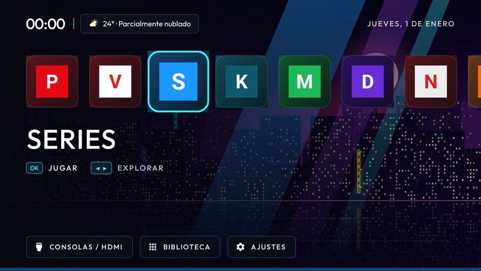
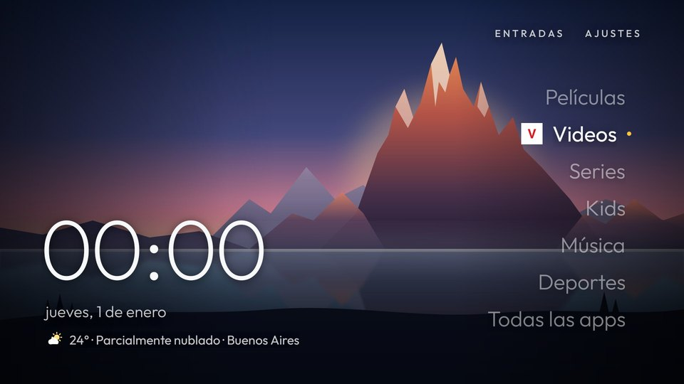
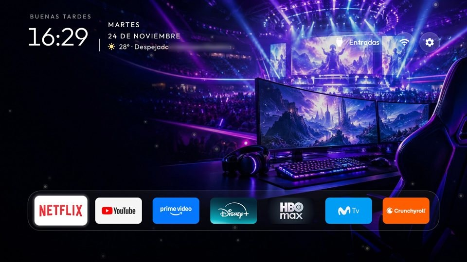
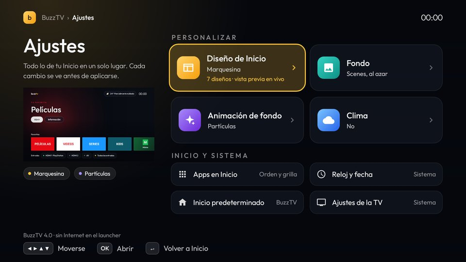
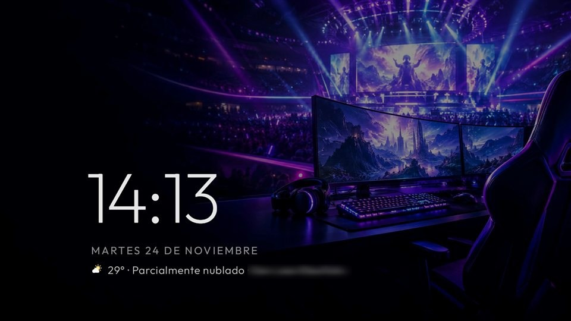

# BuzzTV

> **BuzzTV** es un fork de [CleanYourTV (`Gathin23/cleanyourtv`)](https://github.com/Gathin23/cleanyourtv) bajo licencia **MIT**. Conserva intacta la filosofía del proyecto original —sin publicidad, sin telemetría, sin permiso `INTERNET` en el launcher, desactivación reversible (`pm disable-user`) y compilación 100 % desde el código fuente— y suma **6 diseños de pantalla de inicio** (Aura, el nuevo por defecto, toma el color de la app enfocada), **selector de fondos en la TV**, **9 efectos animados livianos**, **rotación automática configurable** y **clima en vivo con pronóstico de 7 días**.

---

## Los 6 diseños de inicio

En **Configuración del launcher → Diseño / Tema** elegís la arquitectura de tu pantalla de inicio, independiente del fondo y la animación. BuzzTV abre en **Aura**.

| Diseño | Vista |
|---|---|
| **Aura (`aura`, por defecto)**<br>Reloj grande y fino con saludo, fecha y clima; una fila de tarjetas abajo. **La pantalla toma el color de la app enfocada**: un aura suave sube detrás de la fila con ese color y la sigue mientras navegás. |  |
| **Arena (`gaming`, juegos)**<br>HUD arriba (hora, clima, fecha), íconos cuadrados con foco neón, el nombre de la app enorme y haces de luz diagonales con su color. Barra inferior con *Consolas / HDMI*, *Biblioteca* y *Ajustes*. |  |
| **Zen (`minimal`, minimalista)**<br>Solo tipografía sobre el fondo: reloj enorme abajo a la izquierda y las apps como una columna de nombres que se iluminan y muestran su ícono al enfocarlas. |  |
| **Sala (`bento`)**<br>Dashboard Bento: tarjeta con reloj, fecha y clima a la izquierda, grilla 2×2 de apps a la derecha y barra de 3 botones. |  |
| **Cine en casa (`cinema`)**<br>Escenario cinematográfico con título en dorado cálido, botón *Abrir* y tarjetas grandes en la base. |  |
| **Estándar (`standard`)**<br>El diseño clásico de CleanYourTV: reloj y clima arriba a la izquierda y dock horizontal. |  |

> Las vistas de Aura, Arena, Zen y del pronóstico son renders del código real a 1920×1080 con apps de ejemplo; reemplazalas por capturas de tu TV (`tools/tv.py --screenshot`).

### Pronóstico extendido

En todos los diseños, el clima es un botón: **OK** abre el pronóstico de 7 días con las condiciones actuales (sensación, humedad, viento, probabilidad de lluvia) y una tarjeta por día con máxima, mínima y una barra de rango de frío a calor.


---

## Ajustes en la TV y protector de pantalla

Todo se configura directamente con el control remoto desde **Configuración del launcher** (manteniendo pulsado **OK** sobre *Configuración*):

| Configuración del launcher | Protector de pantalla con clima en vivo |
|---|---|
|  |  |

---

## Qué incluye BuzzTV

- **6 diseños de inicio independientes del fondo** (`Aura`, `Arena`, `Zen`, `Sala`, `Cine en casa`, `Estándar`), construidos con un mismo kit visual y navegación por D-pad.
- **Pronóstico extendido de 7 días** al pulsar OK sobre el clima, en cualquier diseño.
- **Selector de fondos en la TV (`Fondo`)**: elegí una imagen puntual, una sección al azar o todos los fondos al azar sin usar la computadora. Los fondos se ven **enteros**: sin zoom que recorte bordes, y una imagen con otra proporción se encuadra sobre un fondo suave de sus propios colores en vez de cortarse.
- **9 efectos animados livianos (`Animación de fondo`)**, **la misma animación en todos los fondos**: `Desactivada`, `Según clima`, o elegir manualmente entre `Lluvia`, `Tormenta` (con relámpagos suaves), `Nieve`, `Estrellas` (con estrellas fugaces), `Rayos de sol`, `Nubes`, `Burbujas`, `Luciérnagas` y `Partículas`. Todos corren a ≤30 fps sin asignaciones por cuadro y se detienen al abrir una app o al apagar la TV.
- **Intervalo de rotación de fondo (`Rotación de fondo`)**: chips rápidos (`1 min`, `5 min`, `10 min`, `20 min`, `1 h`) para fondos rotativos.
- **Clima en vivo (`Clima en vivo`)**: muestra temperatura, condición y ciudad en Inicio y en el protector de pantalla (`ClockDream` / `ClockActivity`), abre el pronóstico de 7 días, y puede adaptar automáticamente la animación del fondo al clima real. El launcher sigue **sin permiso `INTERNET`**: los datos llegan localmente desde el add-on opcional [`addons/weather-sync/`](addons/weather-sync/) vía `ContentProvider` (`content://com.buzztv.weathersync/current`).
- **Debloat seguro y reversible** heredado de CleanYourTV: solo usa `pm disable-user --user 0`, nunca desinstala paquetes del sistema y siempre guarda respaldo previo (`tools/restore.sh` / `tools/restore.ps1`).

---

## Instalación rápida

Requisitos: **JDK 17**, **Android SDK (platform 34, build-tools 34.0.0)** y **ADB** habilitado en la TV (por ejemplo en `192.168.1.50`).

### Windows (PowerShell)

```powershell
# 1. Compilar e instalar el launcher en la TV
powershell -ExecutionPolicy Bypass -File launcher\build-and-install.ps1 -TvHost 192.168.1.50

# 2. (Opcional) Cargar la biblioteca de fondos en la TV
powershell -ExecutionPolicy Bypass -File tools\themes.ps1 -TvHost 192.168.1.50 -All

# 3. (Opcional) Instalar el add-on de clima en vivo
cd addons\weather-sync
.\gradlew.bat assembleRelease
adb -s 192.168.1.50:5555 install -r app\build\outputs\apk\release\app-release.apk
```

### Linux / macOS

```bash
# 1. Compilar e instalar el launcher en la TV
TV_HOST=192.168.1.50 launcher/build-and-install.sh

# 2. (Opcional) Cargar la biblioteca de fondos en la TV
TV_HOST=192.168.1.50 tools/themes.sh --all

# 3. (Opcional) Instalar el add-on de clima en vivo
cd addons/weather-sync && ./gradlew assembleRelease
adb -s 192.168.1.50:5555 install -r app/build/outputs/apk/release/app-release.apk
```

> Al terminar de instalar y configurar, desactivá la depuración ADB / inalámbrica en tu TV y verificá con `tools/adb-closed.py 192.168.1.50`.

---

## Documentación adicional

- [Detalles técnicos de BuzzTV (`docs/buzztv.md`)](docs/buzztv.md)
- [Guía del launcher (`docs/launcher.md`)](docs/launcher.md)
- [Restauración de paquetes (`docs/restore.md`)](docs/restore.md)
- [Solución de problemas (`docs/TROUBLESHOOTING.md`)](docs/TROUBLESHOOTING.md)
- [Procedimiento de debloat seguro (`PROMPT.md`)](PROMPT.md)

## Licencia y créditos

Distribuido bajo licencia **MIT** ([`LICENSE`](LICENSE)).  
Basado en [CleanYourTV](https://github.com/Gathin23/cleanyourtv) por Gathin23 y colaboradores.
