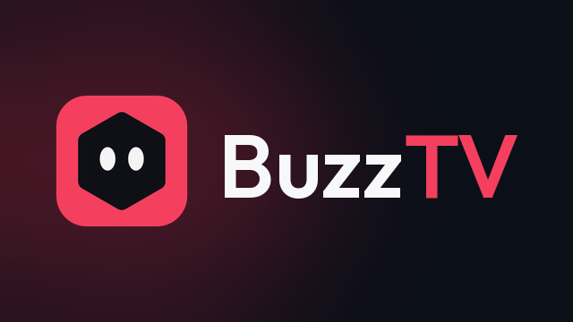
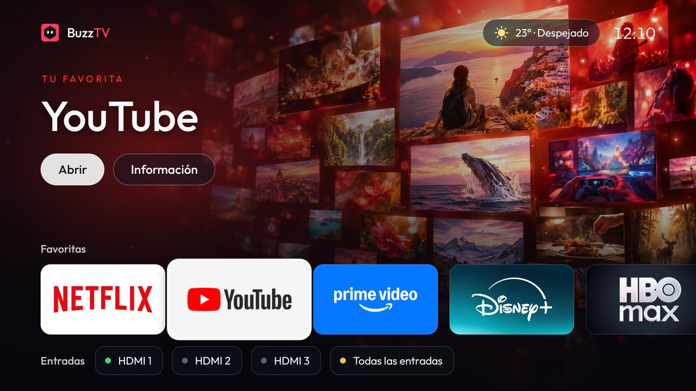
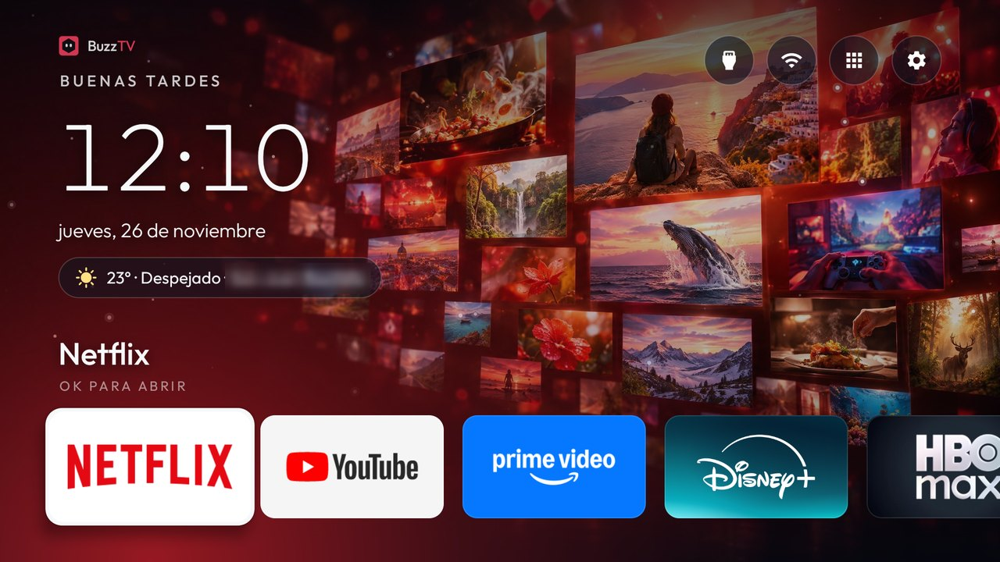
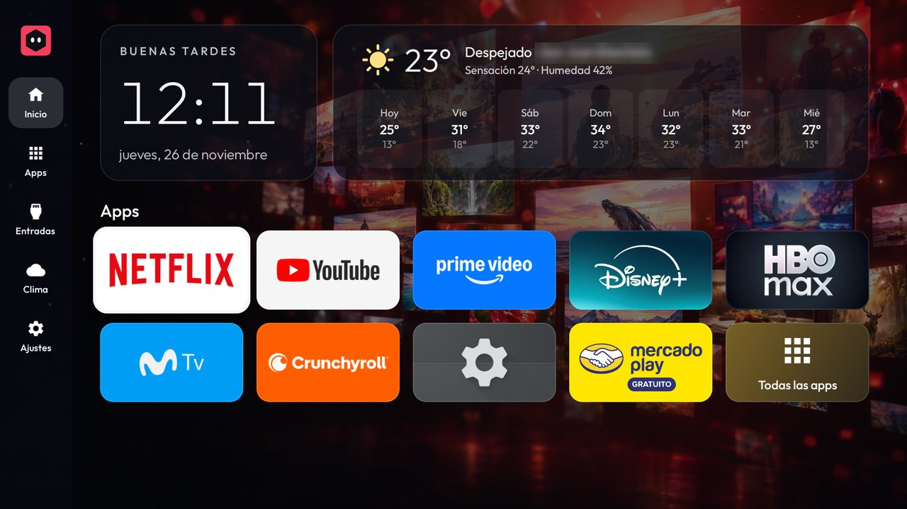
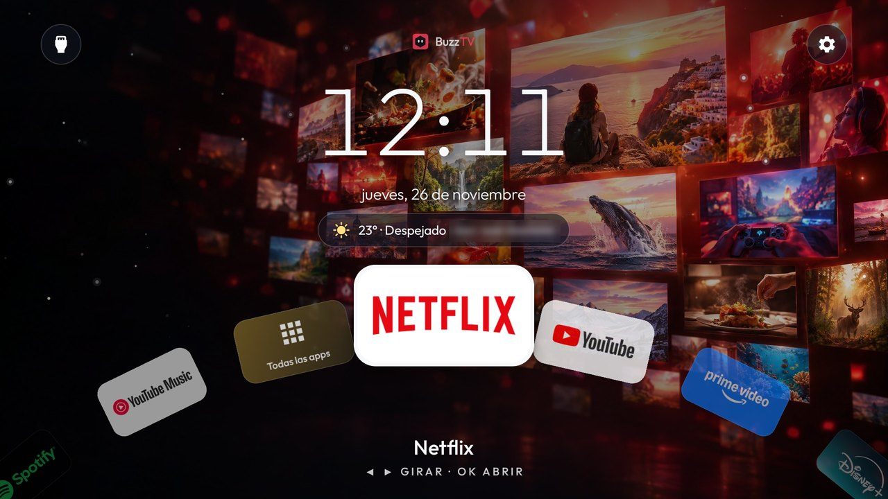
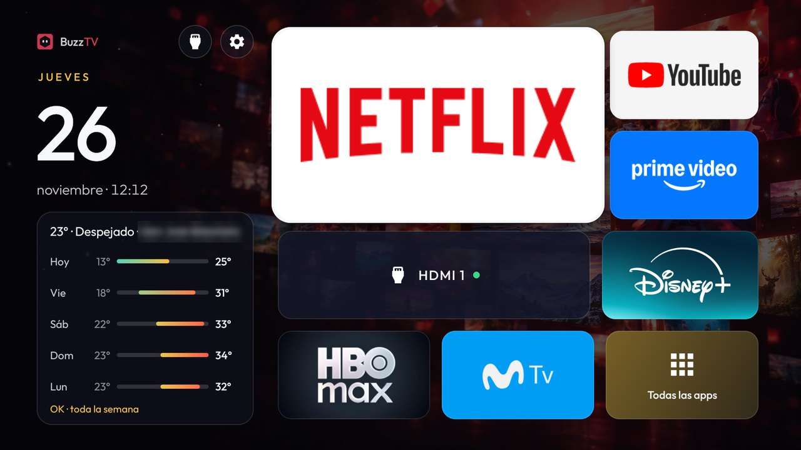
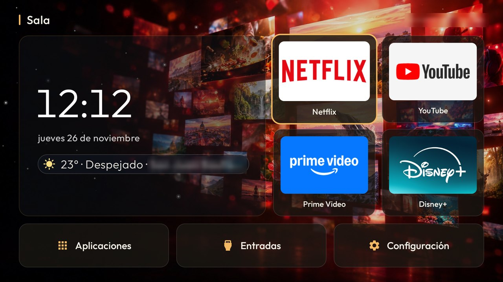
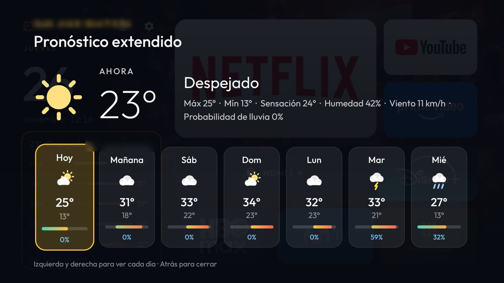
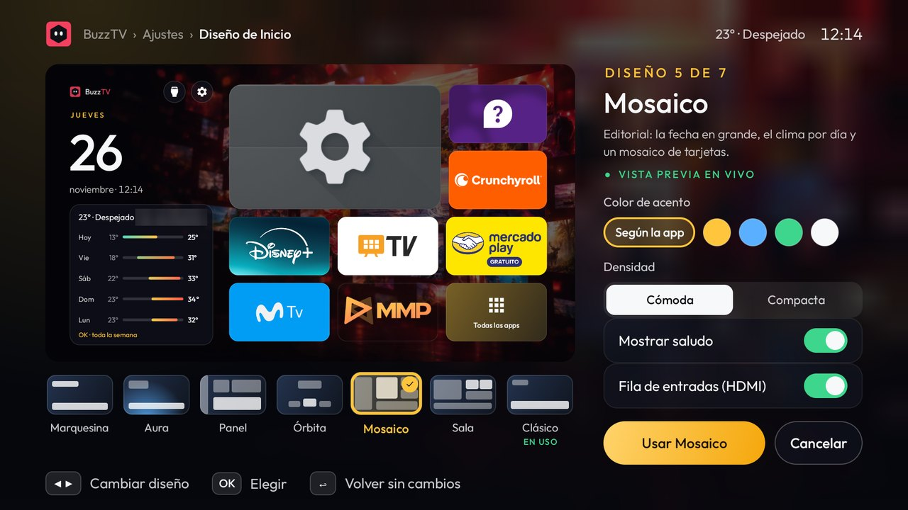
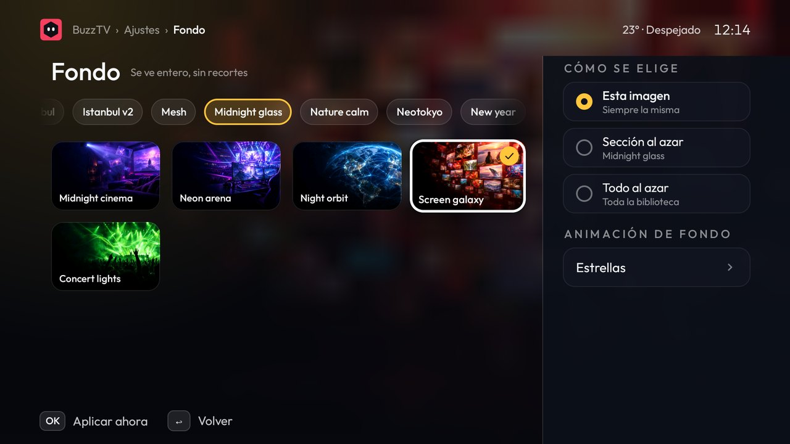

<p align="center"></p>

# BuzzTV

> **BuzzTV** es un fork de [CleanYourTV (`Gathin23/cleanyourtv`)](https://github.com/Gathin23/cleanyourtv) bajo licencia **MIT**. Conserva intacta la filosofía del proyecto original —sin publicidad, sin telemetría, sin permiso `INTERNET` en el launcher, desactivación reversible (`pm disable-user`) y compilación 100 % desde el código fuente— y suma **7 diseños de pantalla de inicio** (Marquesina por defecto), **un menú de ajustes nuevo con vista previa en vivo**, **selector de fondos en la TV**, **9 efectos animados livianos**, **rotación automática configurable** y **clima en vivo con pronóstico de 7 días**.

---

## Los 7 diseños de inicio

En **Ajustes → Diseño de Inicio** elegís la arquitectura de tu pantalla de inicio, independiente del fondo y la animación, viéndola en vivo antes de aplicarla. BuzzTV abre en **Marquesina**.

| Diseño | Vista |
|---|---|
| **Marquesina (`marquee`, por defecto)**<br>La app enfocada ocupa la escena: su nombre en grande, una luz de su color detrás, y los botones *Abrir* e *Información*. Abajo, la fila de favoritas y la de entradas (HDMI con indicador de conectado, *Todas las entradas*). |  |
| **Aura (`aura`)**<br>Reloj grande y fino con saludo, fecha y clima; una fila de tarjetas abajo. Un brillo con el color de la app enfocada sube detrás de la fila y la sigue. |  |
| **Panel (`panel`)**<br>Tablero: barra lateral (Inicio, Apps, Entradas, Clima, Ajustes), tarjeta de reloj, tarjeta de clima con la semana entera y apps en grilla de 5 columnas. |  |
| **Órbita (`orbit`)**<br>Reloj enorme al centro y las apps en un arco que girás con izquierda y derecha; la enfocada queda al centro, más grande. |  |
| **Mosaico (`mosaic`)**<br>Editorial: el día en tipografía grande, el clima con barras por día y un mosaico donde la favorita ocupa una tarjeta grande y la primera entrada HDMI una ancha. Arriba, Entradas y Configuración. |  |
| **Sala (`bento`)**<br>Tarjeta con reloj, fecha y clima a la izquierda, grilla 2×2 de apps a la derecha y barra de 3 botones. |  |
| **Clásico (`standard`)**<br>El dock y la grilla de CleanYourTV. |  |

En cualquiera de estos diseños, **mantener OK sobre una app** abre su pantalla de *Información de la app* de Android (forzar detención, desinstalar, almacenamiento, permisos). En Clásico, mantener OK sigue abriendo su menú, que también incluye *Información de la app*.

En el carrusel de **Diseño de Inicio**, **OK** elige el diseño y lleva directo a **Usar Mosaico** (con el nombre del diseño); el elegido queda marcado con borde dorado y ✓, y el que tenés puesto dice **EN USO**.

Todos comparten el color de acento (según la app o fijo), la densidad (cómoda o compacta), el saludo y la fila de entradas, que se ajustan en la misma pantalla. Quien tenía elegido Modo Juego, Minimalista o Cine en casa los conserva hasta que elija otro.

> Todas las vistas son capturas reales de una Philips Google TV (Android 14) con `tools/tv.py --screenshot`, reducidas a 1280×720. La ciudad del clima y el nombre de la red Wi‑Fi están difuminados.

### Pronóstico extendido

En todos los diseños, el clima es un botón: **OK** abre el pronóstico de 7 días con las condiciones actuales (sensación, humedad, viento, probabilidad de lluvia) y una tarjeta por día con máxima, mínima y una barra de rango de frío a calor.



---

## Ajustes

Mantené **OK** sobre *Configuración* en Inicio para abrir **Ajustes**: una portada con tu Inicio actual en miniatura y las categorías como tarjetas (*Diseño de Inicio*, *Fondo*, *Animación de fondo*, *Clima*, *Apps en Inicio*, *Reloj y fecha*, *Inicio predeterminado*, *Ajustes de la TV*). Cada cambio se guarda al instante, con una guía de botones del control abajo.

| Portada | Diseño de Inicio | Fondo |
|---|---|---|
|  |  |  |

El protector de pantalla (reloj) también muestra el clima en vivo.

---

## Qué incluye BuzzTV

- **7 diseños de inicio independientes del fondo** (`Marquesina`, `Aura`, `Panel`, `Órbita`, `Mosaico`, `Sala`, `Clásico`), construidos con un mismo kit visual y navegación por D-pad.
- **Ajustes rediseñados**: portada con tarjetas, vista previa en vivo del diseño real, galería de fondos con secciones y guía de botones del control.
- **Pronóstico extendido de 7 días** al pulsar OK sobre el clima, en cualquier diseño.
- **Selector de fondos en la TV (`Fondo`)**: elegí una imagen puntual, una sección al azar o todos los fondos al azar sin usar la computadora. Los fondos se ven **enteros**: sin zoom que recorte bordes, y una imagen con otra proporción se encuadra sobre un fondo suave de sus propios colores en vez de cortarse.
- **9 efectos animados livianos (`Animación de fondo`)**, **la misma animación en todos los fondos**: `Desactivada`, `Según clima`, o elegir manualmente entre `Lluvia`, `Tormenta` (con relámpagos suaves), `Nieve`, `Estrellas` (con estrellas fugaces), `Rayos de sol`, `Nubes`, `Burbujas`, `Luciérnagas` y `Partículas`. Todos corren a ≤30 fps sin asignaciones por cuadro y se detienen al abrir una app o al apagar la TV.
- **Intervalo de rotación de fondo (`Rotación de fondo`)**: chips rápidos (`1 min`, `5 min`, `10 min`, `20 min`, `1 h`) para fondos rotativos.
- **Clima en vivo (`Clima en vivo`)**: muestra temperatura, condición y ciudad en Inicio y en el protector de pantalla (`ClockDream` / `ClockActivity`), abre el pronóstico de 7 días, y puede adaptar automáticamente la animación del fondo al clima real. El launcher sigue **sin permiso `INTERNET`**: los datos llegan localmente desde el add-on opcional [`addons/weather-sync/`](addons/weather-sync/) vía `ContentProvider` (`content://com.buzztv.weathersync/current` y `/forecast`).
- **Debloat seguro y reversible** heredado de CleanYourTV: solo usa `pm disable-user --user 0`, nunca desinstala paquetes del sistema y siempre guarda respaldo previo (`tools/restore.sh` / `tools/restore.ps1`).

---

## Instalación rápida

Requisitos: **JDK 17**, **Android SDK (platform 34, build-tools 34.0.0)** y **ADB** habilitado en la TV (por ejemplo en `192.168.1.50`).

### Windows (PowerShell)

```powershell
# 1. Compilar e instalar el launcher en la TV
powershell -ExecutionPolicy Bypass -File launcher\build-and-install.ps1 -TvHost 192.168.1.50

# 2. (Opcional) Cargar la biblioteca de fondos en la TV
powershell -ExecutionPolicy Bypass -File tools\themes.ps1 -TvHost 192.168.1.50 -All

# 3. (Opcional) Instalar el add-on de clima en vivo
cd addons\weather-sync
.\gradlew.bat assembleRelease
adb -s 192.168.1.50:5555 install -r app\build\outputs\apk\release\app-release.apk
```

### Linux / macOS

```bash
# 1. Compilar e instalar el launcher en la TV
TV_HOST=192.168.1.50 launcher/build-and-install.sh

# 2. (Opcional) Cargar la biblioteca de fondos en la TV
TV_HOST=192.168.1.50 tools/themes.sh --all

# 3. (Opcional) Instalar el add-on de clima en vivo
cd addons/weather-sync && ./gradlew assembleRelease
adb -s 192.168.1.50:5555 install -r app/build/outputs/apk/release/app-release.apk
```

> Al terminar de instalar y configurar, desactivá la depuración ADB / inalámbrica en tu TV y verificá con `tools/adb-closed.py 192.168.1.50`.

---

## Documentación adicional

- [Detalles técnicos de BuzzTV (`docs/buzztv.md`)](docs/buzztv.md)
- [Guía del launcher (`docs/launcher.md`)](docs/launcher.md)
- [Restauración de paquetes (`docs/restore.md`)](docs/restore.md)
- [Solución de problemas (`docs/TROUBLESHOOTING.md`)](docs/TROUBLESHOOTING.md)
- [Procedimiento de debloat seguro (`PROMPT.md`)](PROMPT.md)

## Licencia y créditos

El logo de BuzzTV es la marca de [BuzzPrint](https://github.com/ChristianBuzzetti/BuzzPrint), del mismo autor, redibujada como vector (`launcher/app/src/main/res/drawable/buzz_logo.xml`) para el ícono de la app, el banner de Android TV y la firma que llevan los diseños de Inicio y Ajustes.


Distribuido bajo licencia **MIT** ([`LICENSE`](LICENSE)).  
Basado en [CleanYourTV](https://github.com/Gathin23/cleanyourtv) por Gathin23 y colaboradores.
